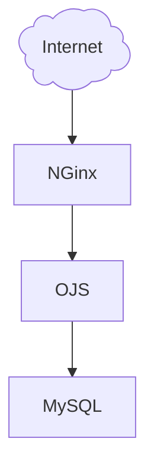

# Roteiro da migração do OJS de 3.4 para 3.5

Esse roteiro tem como objetivo organizar as ações para atualização do OJS

## 1. Criar a estrutura do projeto

```text
/opt/ojs-portal/
├── .env                          # Senhas e variáveis sensíveis (permissão 600)
├── docker-compose.yml            # Orquestração dos serviços principais
├── docker-compose.monitoring.yml # Stack de observabilidade (Uptime Kuma, Prometheus, Grafana)
├── backup-ojs.sh                 # Script automatizado de backup completo e imutável
├── ojs/
│   ├── Dockerfile                # Personalização leve sobre a imagem oficial do PKP
│   ├── php-custom.ini            # Ajustes de limite de upload, memória e hardening PHP
│   └── config.inc.php.example    # Modelo de configuração de segurança do OJS 3.5
├── nginx/
│   ├── nginx.conf                # Regras de segurança, SSL, headers e rate limiting
│   └── certs/                    # Certificados SSL (fullchain.pem / privkey.pem)
├── monitoring/
│   └── prometheus.yml            # Configuração de coleta de métricas (cAdvisor)
└── data/                         # Volumes persistentes (fora da raiz web)
    ├── files/                    # files_dir (manuscritos privados)
    ├── public/                   # Capas, logos e CSS das revistas
    └── monitoring/               # Dados do Uptime Kuma, Prometheus e Grafana
```
Vantagens da abordagem:
1. Leitura e escrita de arquivo mais eficiente
2. Contêineres descartáveis
3. Upgrades rápidos
4. Backups simples e nativos
5. Evita o esgotamento do armazenamento interno do Docker
6. Recuperação imediata em desastres
7. Inspeção e manutenção direta

## 2. Fazer o backup do banco de dados e arquivos
1. Fazer backup dos arquivos:  

    Extrair os arquivos do diretório ***files*** do container para o hospedeiro.
    ```shell
    docker cp <container_3_4>:/var/www/files/. /opt/ojs-portal/data/files
    ```  

    Extrair os arquivos do diretório ***public*** para o hospedeiro
    ```shell
    docker cp <container_3_4>:/var/www/html/public/. /opt/ojs-portal/data/public
    ```
2. Fazer o backup do banco de dados
    ```shell
    mysqdump -u root > /opt/ojs-portal/ojs_34.sql
    ```

## 2. Criar os containers da stack



## 3. Resturação do backup 